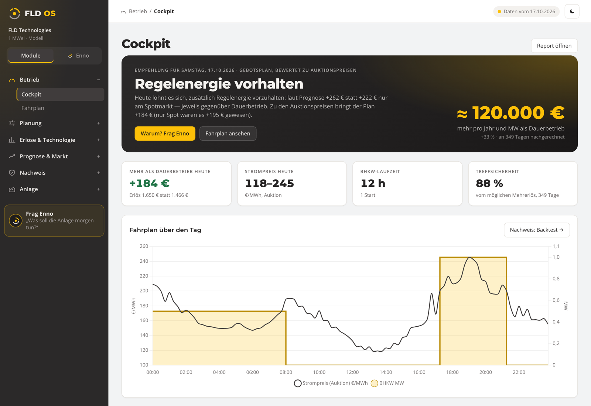
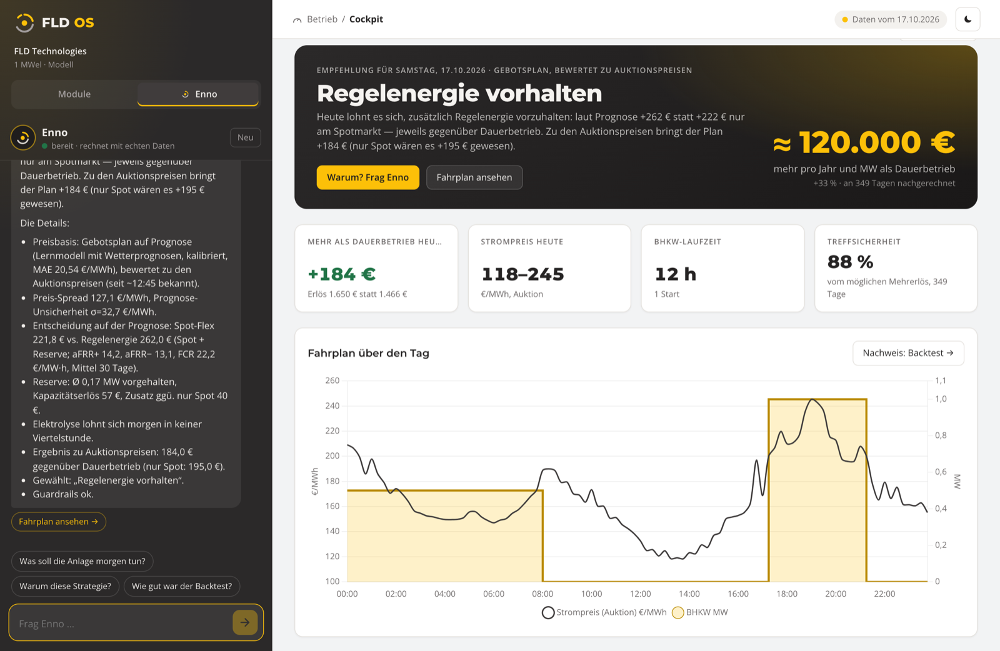
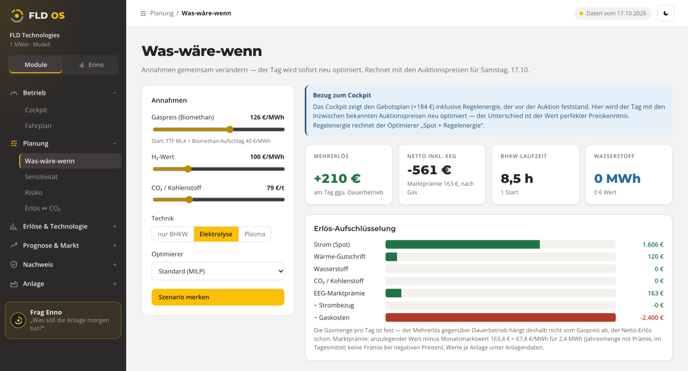
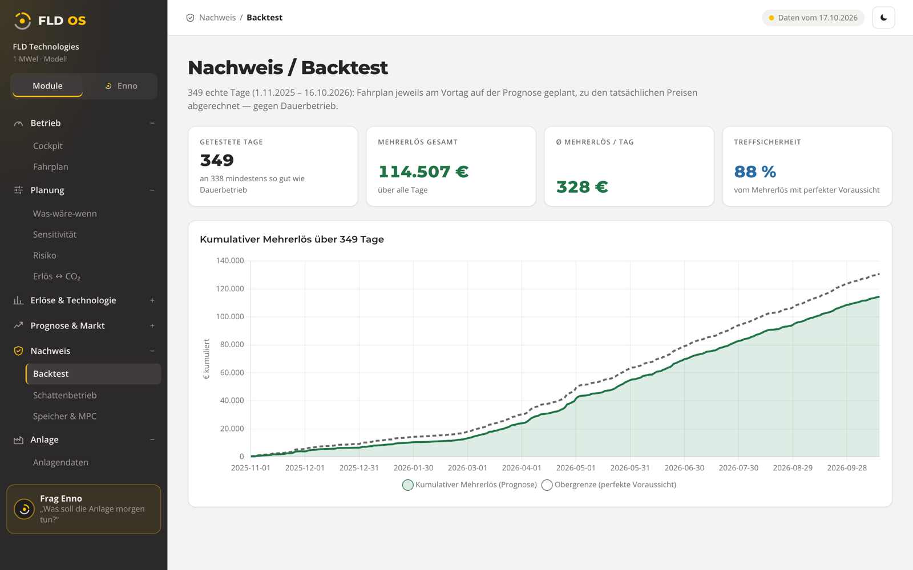
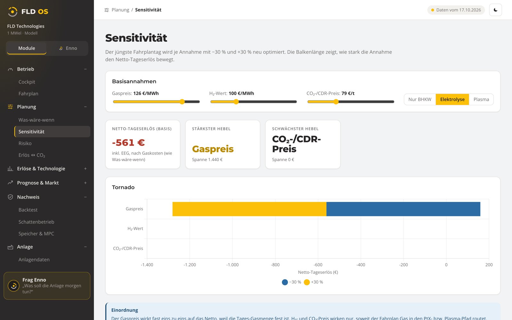
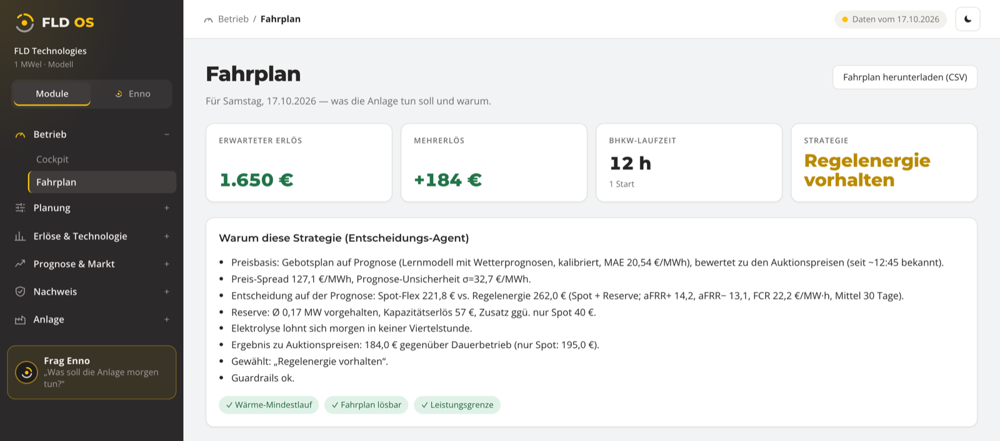

# Enno · FLD OS

An operations platform for a biomethane CHP plant coupled with hydrogen (electrolysis) and plasma pyrolysis, built with
FLD Technologies as the first tenant. Every day, public market and weather data become a quarter-hourly operating schedule,
with revenue, risk and CO₂ analyses, and an agent, **Enno**, that answers operator questions with numbers from the optimizer
instead of inventing them.

German documentation: [README.de.md](README.de.md) · [docs/FLD-OS-ERKLAERT.md](docs/FLD-OS-ERKLAERT.md)



## At a glance

| | |
|---|---|
| **Backtest** | 349 real days (1 Nov 2025 – 16 Oct 2026): each day planned the day before on the forecast, settled at actual prices, against continuous operation |
| **Value** | ≈ 120,000 € more per year and MW than continuous operation (+33 %), for the 1 MWel reference plant model |
| **Forecast quality** | 88 % of the uplift that perfect foresight would have reached; price forecast MAE 20.5 €/MWh, using only knowledge available before the auction |
| **Agent** | Enno answers with results from tool calls into the optimizer, never with invented numbers, and shows the guardrails it checked |

## Screenshots

| Enno explains the decision | What-if: re-optimize the day live |
|---|---|
|  |  |
| **Backtest: cumulative uplift over 349 days** | **Sensitivity: which assumption moves revenue most** |
|  |  |



The interface is in German, because the first operator is a German plant.

## What it does

| Part | Path | Content |
|---|---|---|
| Engine | `engine/` | MILP models (PuLP/CBC): daily schedule, what-if, plasma vs. electrolysis, co-optimization, mean-CVaR risk, Pareto (revenue vs. CO₂), MPC |
| Pipeline | `fldos/pipeline/` | Daily chain from public sources: SMARD, Energy-Charts, Open-Meteo, ENTSO-E, gas/CO₂ prices, German balancing market. The price forecast only uses knowledge available before the auction. |
| API | `fldos/` | FastAPI + PostgreSQL/pgvector, multi-tenant (`tenant_id` from the token), cached analysis endpoints, OpenAPI contract in `docs/openapi.json` |
| Agent | `fldos/enno.py` | Tool-calling agent over the optimizer and data (schedule, decision, what-if MILP, backtest, market, memory search). Without a language model it falls back to a rule-based mode, so there is no cost and no data leaves the system. |
| Web | `web/` | React + Vite: cockpit, schedule, what-if, sensitivity, risk, Pareto, revenue stack, forecast quality, backtest, plant data import |

## How it is checked

- Backend tests with pytest against a dedicated test database, plus an acceptance suite that runs without a database
  (`tests/abnahme`, 42 tests).
- End-to-end tests in a real browser (Playwright): every button, slider, upload and agent suggestion; UI values must equal API
  values; accessibility in light and dark mode.
- Engine golden tests pin the optimizer's results.
- The backtest plans each day on the forecast and settles it at actual prices, against continuous operation.

## Run locally

```bash
python3.12 -m venv .venv && .venv/bin/pip install -e ".[dev]"
createdb fld_os && psql -d fld_os -c "create extension vector"
export FLD_DATABASE_URL=postgresql+asyncpg://$USER@localhost:5432/fld_os PYTHONPATH=.:engine
PYTHONPATH=.:engine .venv/bin/python -m fldos.pipeline   # fetch public data, forecast, backtest, seed the DB
.venv/bin/alembic upgrade head
./run-backend.sh            # API :8031
cd web && npm install && npm run dev   # UI :5173
```

Tests without a database: `FLD_DATABASE_URL=memory:// PYTHONPATH=.:engine .venv/bin/pytest --noconftest -c /dev/null --rootdir=. tests/abnahme`

## Known limits

- Plant parameters are model values of a 1 MWel reference plant until real plant data is available.
- Imported plant data is stored and validated but does not yet feed the optimizers.
- The LLM mode of Enno currently uses AWS Bedrock (EU region); other providers are not wired in yet.
- `docker-compose.yml` is not built or tested yet.
